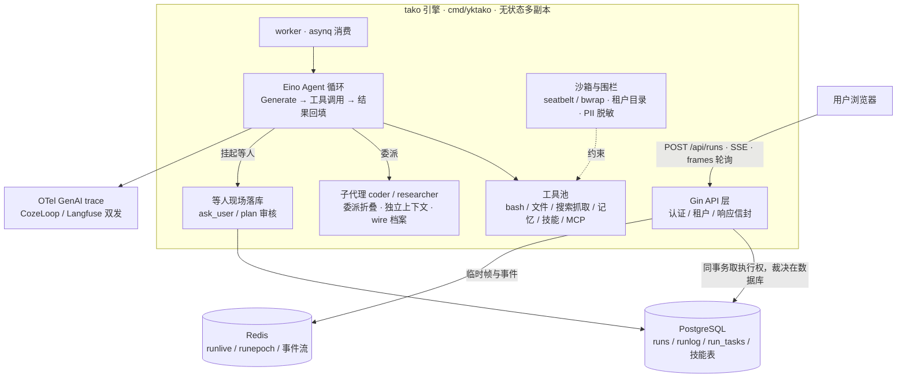

# tako

一个能自己干活的 AI 工作伙伴。你发一句话，它在沙箱里调 bash、读写文件、搜网络、委派子代理，把任务拆成看板一步步推进；崩了能续跑，隔天的对话能召回。多租户，团队共享账号与额度，不共享文件。

技术栈：**Go 1.27 + [Eino](https://github.com/cloudwego/eino)**（CloudWeGo）+ Gin + PostgreSQL/pgvector + Redis，前端 Vue 3 + Vite。代码在 `yk-tako-eino/`，唯一入口 `cmd/yktako`。

## 能力清单

| 类别 | 功能 | 状态 |
|---|---|---|
| **主循环** | 工具调用（bash / 文件 / 网络搜索与抓取 / 记忆 / MCP） | ✅ |
| | Plan 审核与追问澄清（写/执行前挂起等人批） | ✅ |
| | 任务看板（数据在 PostgreSQL，活得过 `kill -9`） | ✅ |
| | 每一次工具调用都上屏 | ✅ |
| | 工具分级与延迟加载（`tool_search` 按 BM25 检索挂载；工具定义不占提示词前缀） | ✅ |
| **上下文** | 压缩 + 中途折叠 + 溢出救援 | ✅ |
| | 图片落盘换占位符，模型按需读取 | ✅ |
| | token 用量可见 | ✅ |
| | `read_file` 分页读 / `bash` 留尾 + 全文落盘 | ✅ |
| **子代理** | 委派 + 上下文隔离 + 折叠回传 | ✅ |
| | 持久档案与 resume（跑完还能接着问） | ✅ |
| | 工具权限分档（白名单 / 排除清单；普通子代理拿不到技能工具，也读不到技能目录） | ✅ |
| **记忆** | 长期记忆抽取与自动召回 | ✅ |
| | 跨会话对话召回 | ✅ |
| **安全** | bash 沙箱（macOS seatbelt / Linux bwrap） | ✅ |
| | 文件围栏 + 同文件并发写防护 | ✅ |
| | PII 脱敏（工具出口 / 模型输入 / 记忆入库） | ✅ |
| | MCP 进程围栏 | ✅ |
| **运输** | 四个产品 API 拉取帧 | ✅ |
| | SSE 流式端点 | ✅ |
| | 崩溃续跑（客户端触发） | 🔶 |
| **多租户** | 注册登录 + 租户 + 成员邀请 | ✅ |
| | 团队协作前端 | ✅ |
| | 租户配额与并发准入（日 token 预算 / 并发上限，裁决在数据库事务里） | ✅ |
| | 多 Agent 协作 | ⬜ |
| **多入口** | Web | ✅ |
| | IM / cron | ⬜ |
| **前端** | 多会话并发（切走不打断，草稿与游标随会话保留） | ✅ |
| **治理** | 项目目录 + 文件清单 | ✅ |
| | 删除与档案清理 | ✅ |
| | 变更事件通道 | ✅ |
| **可观测** | 运行级 OTel trace（CozeLoop / Langfuse，可双发） | ✅ |
| **质量** | 三层验收：接口契约有机器断言 / 验收场景一键重跑 / 公开基准双臂对照 | ✅ |
| **技能** | 技能包安装 / 使用 / 禁用 | ✅ |
| | 对话内安装需管理员确认 + 依赖检查 | ✅ |
| | 自定义工具上传 | ✅ |

> ✅ 已落地 · 🔶 部分落地 · ⬜ 未做。完整状态与设计见 [doc/16](doc/16-能力复刻总规划.md)。

## 架构



引擎无状态：互斥与租约全落在 PostgreSQL，临时帧与事件放 Redis——任一进程崩了，租约过期即解锁，另一副本接管。

## 并发控制：为什么不用分布式锁

tako 不使用应用层分布式锁（Redis `SETNX` 那类），互斥下沉到存储层原语：

- **会话级单 run 准入**：`runs` 表的部分唯一索引（`UNIQUE session_id WHERE status='running'`），INSERT 冲突即 409——锁就是数据本身。
- **租约 + 接管令牌**：`lease_until` 列当 TTL（进程死了自动过期），`lease_epoch` 列当 fencing token（被接管后旧写自然失败）。
- **文件并发写**：`flock` 排它锁 + sha256 指纹比对，比对在锁内做，防旧版覆盖新版。
- **配额 / 并发上限**：短事务内 `FOR UPDATE` / `pg_advisory_lock`，事务结束自动释放。

核心运行路径通过设计消除了竞态：单 run 单 worker 串行、历史表只增不删、状态机单向终态不可逆。锁只处理并发发起和崩溃接管两个边界。多副本部署时，数据库是唯一裁判。

当前所有互斥都能下沉到 PG / 磁盘，因为被保护的数据就在这些存储层。若将来需要协调存储层之外的资源（第三方 API 全局限流、跨服务复合操作），才需要引入分布式锁。

完整设计与对比见 [doc/61](doc/61-并发控制设计.md)。

## 请求怎么流转

```
用户 → POST /api/runs → 数据库互斥（同一会话只跑一个 run）→ worker
  → 装配租户运行时（模型 / 工具 / 子代理 / MCP / 记忆）
  → 模型循环：Generate → 工具调用 → 写运行日志 → 推帧
  → 帧持久化到 PostgreSQL，临时面放 Redis → SSE / 轮询双路给客户端
  → run 结束：异步记忆抽取 + 对话建索引
```

互斥与租约在 PostgreSQL，临时态在 Redis，天然支持多副本部署——进程崩溃后租约过期，会话自动解锁。

## 基准测试

在 GAIA L1 的 25 道纯文本题上，用同一模型（deepseek-flash）、每题跑 5 次，分别量天花板（Pass@5：至少做对一次）和可靠性（pass^5：次次做对）：

| 指标 | tako | 同类 harness |
|---|---|---|
| Pass@5 | 24 / 25 | 23 / 25 |
| pass^5 | 20 / 25 | 14 / 25 |
| 平均模型轮次 / 题 | 4.8 | 11.8 |
| token 总量 | 10.8M | 34.5M |

结论：「能做对一次」两者几乎一样；「次次做对」差出来的部分主要是预算与超时（对比臂的 22 个未完成轮次集中在 8 道题上），不是能力差。tako 用约 1/3 的 token 和不到一半的轮次达到了相近的天花板。

完整口径、归因方法与过程见 [doc/56](doc/56-Agent测试与基准选型.md)。

## 五个关键取舍

每条 = 当时的问题 / 怎么裁 / 代价。完整决策档案（43 条）在 [doc/problems](doc/problems/README.md)。

1. **准入裁决在数据库，不在进程** — 「最多同时跑几个」若在应用层「数一遍 → 比上限 → 放行」，并发下必超发（实测上限 2 放进 4 场）。裁：数与放行收进同一笔 PG 事务 + `pg_advisory_xact_lock`。代价：每次放行多一次锁等待。（[doc/43](doc/43-租户并发闸入DB.md)）
2. **非典型 HITL** — 模型觉得需要人拍板时调 `ask_user`，页面出一张问题卡；人答完，这句答案就当这次工具调用的结果回给模型，它接着往下跑。不走 eino 的 `compose.Interrupt`（底层 `core.Interrupt`）：那套把执行图停在某个组件的地址上、存一份 checkpoint 快照，恢复时再从那个地址重入；tako 这边图从不停，挂起只是一次调用在等答案，现场落在 PG 的 `run_questions` 行上，进程死了也能由 resume 重建。代价：模型该问的时候没问，人就没有插手的机会；问起来不设上限，人几天不回，这个会话就一直占着。（[doc/47](doc/47-Plan审核与追问澄清.md) §3.4）
3. **崩溃后接着往下跑，不整轮重来** — 崩之前模型说过的话、已经跑出结果的工具调用，都从 `run_journal` 账本里捞回来原样喂给模型，模型看着这些自己往下走；只有那一次「工具已经叫起来、结果还没拿到」的调用不重跑，只回一句「这次中断了、没拿到结果，要不要重来你定」。代价是那次调用到底有没有留下副作用说不准，所以宁可把重不重来的决定交给模型，也不自动替它跑一遍。（[doc/30](doc/30-崩溃续跑.md)、[doc/39](doc/39-子代理持久化与resume.md)）
4. **把技能转成任务** — 每场 run 起手，在系统提示词末尾拼一行目录：名字、一句话描述、文件路径。模型要用哪个，就调 `use_skill` 把说明书整篇读进上下文，照着它把步骤一条条建到看板上；任务一建好，说明书就折成一行占位，看板上那几条才是要干的活，它不会被 Compact 折掉，每条任务自带标题和说明，细节不丢。（[doc/52](doc/52-技能.md)）
5. **工具与技能目录不截断、不做搜索** — 目录体积是已知天花板，成本靠作用域与禁用两项控制，不为省 token 把名字藏起来。代价：目录涨大后 prompt 成本可见上升，届时再评估检索层。（[doc/52](doc/52-技能.md) §9）

## 失败与教训

## 快速开始

### 一键开发环境

```bash
./scripts/dev.sh
```

前置条件：

- Go 1.27（脚本会把 `$HOME/sdk/go1.27.0/bin` 加进 PATH）
- Node.js >= 20.19（Vite 7 要求）
- Redis 与 Postgres：端口上已有实例就复用；空闲时脚本用本机 `redis-server` 和 `initdb/pg_ctl` 起本地实例（数据在 `tmp/pg-5433/`）
- `yk-tako-eino/.env` 里配好模型密钥（如 `DEEPSEEK_API_KEY`、`DEEPSEEK_BASE_URL`、`TAKO_MODEL`）

默认前端 <http://127.0.0.1:5173>、引擎 `127.0.0.1:8901`、Redis `127.0.0.1:6390`、Postgres `127.0.0.1:5433/tako`。

第一次用先注册账号（注册即建个人租户，密码至少 8 位）：

```bash
curl -s -X POST http://127.0.0.1:8901/api/auth/signup \
  -H 'Content-Type: application/json' \
  -d '{"email":"you@example.com","password":"changeme123"}'
```

`Ctrl-C` 一起停。常用子命令：

```bash
./scripts/dev.sh status      # 有没有在跑（读 pidfile）
./scripts/dev.sh stop        # 发 TERM，走和 Ctrl-C 同一条收尾
./scripts/dev.sh restart     # 停掉再前台起

ENGINE_PORT=8905 WEB_PORT=5180 REDIS_ADDR=127.0.0.1:6392 PG_PORT=5434 ./scripts/dev.sh
```

脚本会自动生成开发用的 `TAKO_JWT_SECRET` / `TAKO_DATA_KEY`（至少 32 字节）；不走 dev.sh 时必须自己 export。

### 测试

```bash
cd yk-tako-eino
PATH="$HOME/sdk/go1.27.0/bin:$PATH" go test ./internal/runengine

cd web
npm run typecheck
```

单元测试不打模型，不需要 API Key。

## 项目结构

```text
yk-tako-eino/          Go 引擎 + Vue 前端（主代码目录）
  cmd/yktako/          唯一入口
  internal/runengine/  运行引擎：API、worker、存储、工具、子代理、记忆、MCP
  internal/config/     模型厂商目录、模型客户端与系统提示词
  internal/observability/  OTel trace 装配与内容序列化
  agents/              内置子代理规格（coder.md / researcher.md）
  web/                 Vue 3 + Vite 前端
doc/                   设计文档（现行）；索引见 doc/README.md
  log/                 按日期的记录：交接、执行台账、文章（不施工）
  archive/             旧线与旧代归档（不施工）
scripts/dev.sh         一键开发环境
scripts/acceptance/    可机器重跑的验收：期望响应 + 断言器 + 活体抽验
scripts/bench/         公开基准（GAIA 等）测试脚本
tmp/                   临时文件（已忽略，不入库）
```

## 下一步做什么

**待完成（已定方向）**——排序与依据见 [doc/16 §5.1](doc/16-能力复刻总规划.md)：

- **IM / cron 入口**：多入口统一路由的第二个入口（推送替代拉取、消息即 run 触发源）。
- **多 Agent 编排**：在子代理原语（委派 / 上下文隔离 / 持久档案 / 权限分档）之上做任务拆分与动态调度。
- **场景化 Eval**：验收从「接口有没有按约回」推到「活有没有干完」（方案 [doc/45](doc/45-场景化Eval框架.md)，待点头）。

**待评估（候选，未拍板）**——完整候选池与借鉴来源在 [doc/16 §2b](doc/16-能力复刻总规划.md)：

- 浏览器操作（Work Agent 方向：DOM / 截图理解页面，每步重新观察）
- 跨子代理的结构化产物黑板（blackboard）
- run 级预算中断（现有配额是租户日 token；run 级超限自动停）
- Prompt 缓存边界的进一步压榨（静态前缀声明、逐轮微压缩）
- 受限自修改（RSI）实验：固定评测集 + 候选版本晋级 / 回滚

## 文档与协作

- [doc/README.md](doc/README.md)：文档索引——分清哪些是现行文档、哪些是记录与归档，以及 `doc/log/` 里的历史文章怎么读。
- [doc/16-能力复刻总规划.md](doc/16-能力复刻总规划.md)：产品能力总览——tako 做什么、做到哪了、下一步做什么。
- [doc/19-v6/19-运行引擎架构-v6.md](doc/19-v6/19-运行引擎架构-v6.md)：第六代运行引擎架构入口（v6 是代际编号，不是服务版本）。
- [doc/53-模块地图.md](doc/53-模块地图.md)：代码结构索引——每个模块落在哪些文件、对应哪篇方案。
- [doc/problems/README.md](doc/problems/README.md)：设计决策档案库——当时遇到什么问题、桌上有哪些候选、为什么这么裁。
- [AGENTS.md](AGENTS.md)：协作规范。
- [LICENSE](LICENSE)：MIT 协议。
