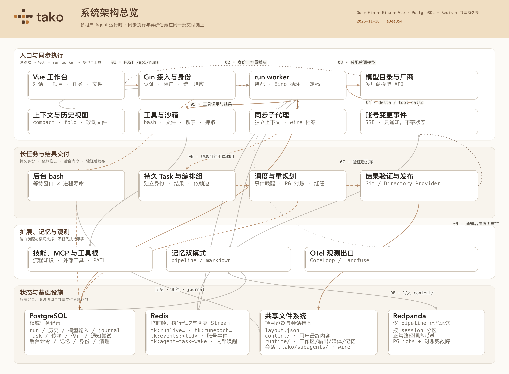
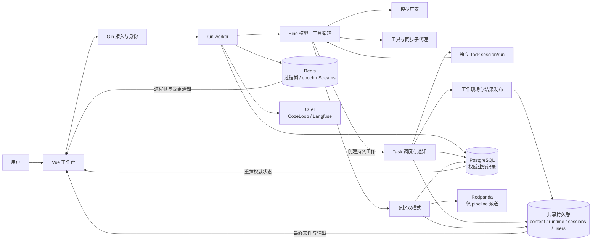

# tako

tako 是一个多租户 Agent 运行时与 AI 工作台。你给它一个目标，它不仅能对话，还能读写项目、执行命令、搜索资料、委派子代理，把长工作拆成可恢复的 Task，最后交付一份可以打开检查的文件。

例如你说：「调研两个方案，修改这个项目，跑完构建，最后给我一份报告；构建期间我还要问别的问题。」主 Agent 可以直接修改文件，让两件调研 Task 按依赖推进，把长构建留在后台；需要结果时主动等待，完成后验证并发布报告。页面能看到工具调用、任务进展和改动文件，而不是只看到一句“正在处理”。

tako **不是知识库产品**：记忆与检索只支撑 Agent 工作。它也**不是多人协同编辑产品**：一个员工一个项目，项目文件由本人的多场会话共享；团队共享账号、额度与审计，不共享文件。

技术栈：**Go 1.27 + [Eino](https://github.com/cloudwego/eino) + Gin + PostgreSQL/pgvector + Redis**，前端 **Vue 3 + Vite**。`pipeline` 记忆模式另用 Redpanda 派送抽取作业。唯一服务入口是 `yk-tako-eino/cmd/yktako`。

## 架构导览

**在线文档站**：<https://ykworm.github.io/yk-tako/> —— 四张可交互说明页，加上全部文档的网页版（每个 md 一页）。改 `doc/` 里的东西推 main 就自动重新发布。

[](https://ykworm.github.io/yk-tako/assets/tako-architecture.html)

四张说明页，点开即用：

- [系统架构总览](https://ykworm.github.io/yk-tako/assets/tako-architecture.html)：谁把什么交给谁，同步执行与异步任务怎样接成一条交付链。
- [单场 run 生命周期](https://ykworm.github.io/yk-tako/assets/tako-run-lifecycle.html)：创建、模型工具循环、九种帧、定稿、等人、压缩与显式续跑。
- [长任务与多 Agent 编排](https://ykworm.github.io/yk-tako/assets/tako-orchestration.html)：持久 Task、依赖、shared/isolated、后台 bash、发布、通知与重规划。
- [数据、状态与存储](https://ykworm.github.io/yk-tako/assets/tako-data-model.html)：PostgreSQL 表、四类 Redis 临时状态、项目 content/runtime、会话 wire 与记忆双模式。

离线看：克隆仓库后用浏览器打开 `doc/assets/` 下的同名 HTML，无需构建或联网（GitHub 上点 HTML 文件只会显示源码，所以上面的链接指向线上站）。

这些页面是现行文档的导读，不是另一份施工契约；实现与专项文档冲突时，以代码和专项文档为准。

全部文档另有网页版：`doc/html/` 下每个 md 对应一页，由 `scripts/build-doc-html.py` 从 md 自动生成（内容以 md 为准）。线上入口是 <https://ykworm.github.io/yk-tako/>；本地入口是 `doc/index.html`（站点首页）与 `doc/html/index.html`（全部文档索引）。

## 快速开始

### 1. 启动开发环境

前置条件：

- Go 1.27；脚本会把 `$HOME/sdk/go1.27.0/bin` 加进 PATH。
- Node.js >= 20.19。
- 本机可用的 Redis 与 PostgreSQL 工具；端口已有实例就复用，否则脚本会在本地创建开发实例。
- 至少一个可用模型。可以在启动前配置平台默认模型，也可以注册后在配置页给当前租户安装模型密钥。租户没有可用密钥时，run 会按设计拒绝，而不是悄悄换用别人的 Key。

在仓库根目录执行：

```bash
./scripts/dev.sh
```

默认地址：

- 前端：<http://127.0.0.1:5173>
- 引擎：`127.0.0.1:8901`
- Redis：`127.0.0.1:6390`
- PostgreSQL：`127.0.0.1:5433/tako`

`dev.sh` 会自动生成开发用的 `TAKO_JWT_SECRET` 和 `TAKO_DATA_KEY`。手动启动引擎时，需要自行提供至少 32 字节的这两个值。

### 2. 注册并配置租户

第一次使用可以先用 API 注册；注册会创建个人租户，密码至少 8 位：

```bash
curl -s -X POST http://127.0.0.1:8901/api/auth/signup \
  -H 'Content-Type: application/json' \
  -d '{"email":"you@example.com","password":"changeme123"}'
```

然后打开前端，在配置页为当前租户安装模型密钥，再登录并发送第一条消息。完整业务链是：**注册 → 配置当前租户模型 → 登录 → 发消息**。

### 3. 选择记忆模式

默认 `pipeline` 模式使用 PostgreSQL 两层记忆、Redpanda 异步抽取和 BM25 召回。若启用后台抽取，需要配置 `TAKO_REDPANDA_BROKERS / USER / PASSWORD / MECH`；不配 broker 也能启动引擎，但抽取作业会留在队列里等待，不能当作已经完成。

如果希望少一套 MQ 依赖，可在启动前设置：

```bash
export TAKO_MEMORY_MODE=markdown
```

此模式同步维护用户 `USER.md` 与项目 `runtime/memory/MEMORY.md`，不启动 Redpanda 和 BM25。两种模式共用对话块召回。

### 常用开发命令

```bash
./scripts/dev.sh status
./scripts/dev.sh stop
./scripts/dev.sh restart

ENGINE_PORT=8905 WEB_PORT=5180 REDIS_ADDR=127.0.0.1:6392 PG_PORT=5434 ./scripts/dev.sh
```

### 测试与构建

```bash
cd yk-tako-eino
PATH="$HOME/sdk/go1.27.0/bin:$PATH" go test ./internal/runengine
PATH="$HOME/sdk/go1.27.0/bin:$PATH" go vet ./internal/runengine
PATH="$HOME/sdk/go1.27.0/bin:$PATH" go build ./cmd/yktako

cd web
npm run typecheck
npm run build
```

单元测试不调用模型，不需要 API Key。契约与活体验收见 [scripts/acceptance/README.md](scripts/acceptance/README.md)；请使用隔离引擎，不要拿开发库做全量重置。

## 现在能做什么

| 领域 | 已落地的能力 | 边界与验证口径 |
|---|---|---|
| 对话与工具 | bash、文件、搜索与抓取、历史查询、MCP；工具定义按需检索；每次工具调用上屏 | macOS seatbelt 与 Linux bwrap 代码均已落地；Linux 活体脚本已入库，但当前开发机未实跑 |
| 长命令 | bash 前台等待超时后保留进程并返回 `bj_…`；读取输出、有限等待、停止进程组、持久通知与失联处理 | 默认前台等待窗口为 30 秒，可配置；引擎重启不自动重放命令，`interrupted` 不表示仍在运行 |
| 多 Agent 编排 | 持久 Task、初始依赖图、有界计划修订、Task 内提问、依赖推进、失败阻断、整组交付与执行历程 | 不是 Agent 自由群聊；shared 当前同组串行，isolated 当前同组最多两件并行 |
| 工作区与发布 | Git worktree 或普通目录副本、不可变结果、结果验证、项目级发布协调与受阻重试 | 中间结果不直接写 `content/`；不承诺外部副作用 exactly-once |
| 重规划 | 最终节点未开始时同组修订；原组已交付后判断继任组；复用旧结果并记录 handoff | 只有 `goalAssessment.outcome == feasible` 才能创建继任组；不可行或不确定不会自动新建 |
| 同步子代理 | 独立上下文、委派折叠、coder/researcher 权限边界、完整 wire 档案与 resume | 父 Agent 等待结果；它不是另一种后台 Task |
| 项目与文件 | 项目目录树、文件预览与下载、Markdown 预览、改动文件回执、删除与过期清理 | `content/` 是用户内容，`runtime/` 是工作现场、结果、输出、媒体与项目记忆 |
| 上下文 | compact、mid-run fold、溢出处理、图片落盘与按需重读、分页读取、长输出留尾和全文落盘 | 页面历史与模型输入分开；压缩不会把用户历史替换成摘要 |
| 记忆 | `pipeline` / `markdown` 两种模式；常驻与按需召回；`search_memory` 时点与历史链；对话块召回 | 旧 `notes` 路径已迁移退役；`markdown` 不启动 MQ 与 BM25 |
| 人工参与 | `ask_user` 追问、Plan 审核、技能安装确认；问答现场落库，崩溃后可接回 | 越界命令由沙箱拒绝，不另做框架替模型拦截的审批回路 |
| 多租户与团队 | 注册登录、租户、成员邀请、模型配置、日 token 与并发容量、存储额度 | 一个员工一个项目；不做团队共享文件、计费、SSO 与 API Key 自服务 |
| 前端 | 多会话并行、项目会话树、任务处理提醒、右侧工作区、后台命令视图、账号事件同步 | 事件只通知失效，页面仍须重拉权威状态 |
| 可靠性 | run 租约与执行代次、journal、显式 resume、Task 通知恢复、后台命令失联对账 | 普通 run 由客户端显式续跑，不做服务端自动巡检接管 |
| 可观测 | OTel GenAI span，CozeLoop / Langfuse 单发或双发 | 观测出口不是恢复或业务历史的权威来源，导出失败不影响 run |
| 技能与扩展 | 技能安装、更新、禁用、依赖检查、对话内确认；租户上传可执行文件 | 工具根进入子进程 PATH，不等于自动新增模型工具 schema；不做技能市场 |
| 质量 | 单元契约检查、机器可重跑活体验收、公开基准双臂对照 | 场景化 Eval 仍待点头；公开基准不替代确定性回归 |

## 先分清这些对象

| 对象 | 调用方是否等待 | 身份与记录在哪里 | 主要用途 |
|---|---|---|---|
| `session` | 不是执行单元 | PostgreSQL `sessions`；另有会话目录 | 一串对话或一件 Task 的执行归属 |
| `run` | HTTP 创建后立即返回，页面随后观察 | `runs`、runlog、journal、Redis 临时帧 | 一条用户消息或一次 Task/交付处理触发的一场执行 |
| 直接工具 | 等本次工具结果 | 调用与结果进入 run 帧和历史 | 当前上下文能完成的动作 |
| 同步子代理 | 父 Agent 等独立上下文的结果 | 独立模型上下文；会话 `.tako/subagents/` wire | 隔离中间过程，并立即拿结果继续 |
| run 内 Todo | 不是独立执行单元 | PostgreSQL `run_tasks` | 展示当前 run 的步骤与结果，不参与 DAG 调度 |
| 持久 Task | 可离开，也可 `wait_task` | PG Task/依赖/通知 + 独立 session/run | 后台推进、依赖、独立恢复与整组交付 |
| 后台 bash | 等待窗口后可离开，也可 `bash_output` | PG `background_jobs` + runtime 输出 + owner 进程 | 长构建、长测试与持续输出 |

## 系统结构



进程内不保存权威运行状态。PostgreSQL 负责业务事实与事务协调，Redis 负责临时过程帧、执行代次和变更通知，共享持久卷负责真实文件，Redpanda 只负责 `pipeline` 记忆派送。普通 run 崩溃后由用户显式 resume；Task、后台命令和记忆作业各有自己的恢复规则，不能统称“另一副本自动重放”。

## 四个关键工程取舍

1. **执行权与容量由数据库裁决，而不是先数后放。** 同一会话的唯一运行由 `runs` 部分唯一索引保证；租户容量在同一笔 PG 事务里计数与放行，并使用 advisory lock 串起竞争请求。代价是放行时可能多一次锁等待，但不会出现两个副本同时看到“尚未满员”而一起超发。详见 [doc/43](doc/43-租户并发闸入DB.md) 与 [doc/61](doc/61-并发控制设计.md)。

2. **页面历史、模型输入和恢复记录分开。** `runlog_entries` 保存实际产出，`run_model_messages` 保存下一枪模型该看到什么，`run_journal` 保存每一步意图与结果。compact 只改第二份，resume 使用第三份。代价是多份数据与明确写入纪律，换来的是用户历史不被摘要覆盖、恢复不依赖被压缩的聊天记录。

3. **等人与恢复都落库，外部副作用不盲目重做。** 追问、方案和安装确认写 `run_questions`；续跑时 `lease_epoch+1`，旧执行者无法继续写。已经取得结果的工具可以回放，只有 intent 没有结果的调用标记中断，由模型结合现状决定下一步。代价是那次调用的副作用可能需要人工判断，但避免了自动重复写文件或调用外部服务。

4. **中间结果与最终内容分开。** 项目 `content/` 只放用户内容与最终发布结果，`runtime/` 放工作现场、不可变结果、输出、媒体与项目记忆。短写入使用锁内版本校验、同目录临时文件和原子替换；Task 最终结果还要验证与发布。代价是多一次结果固化与发布，但用户不会把并行任务的半成品当成最终交付。详见 [doc/71](doc/71-文件写入竞争.md)、[doc/74](doc/74-并行任务工作区隔离.md) 与 [doc/76](doc/76-项目内容目录与运行资源容器.md)。

## 记忆：两种独立运行模式

| 维度 | `pipeline` | `markdown` |
|---|---|---|
| 长期记忆位置 | PG `memory_items` 的 resident / recall 两层 | 用户 `USER.md` + 项目 `runtime/memory/MEMORY.md` |
| 写入 | inrun / postrun 作业，统一抽取代理处理 | 主 Agent 调 memory 工具，同步 add / replace / remove / batch |
| 派送与故障 | Redpanda 正常派送，PG jobs、前置条件与对账器处理补投和崩溃 | 无 MQ；锁内重读、跨副本 advisory lock 与原子替换 |
| 读取 | 常驻读取、BM25 召回、`search_memory` 时点与历史链 | 后续回合直接读取文件，不启动 BM25 |
| 项目删除 | 清当前项目 workspace 范围记忆与相关 jobs，保留 user 行 | 项目 MEMORY.md 随容器清理，用户 USER.md 保留 |
| 对话块 | 两种模式共用 `dialogue_chunks` | 两种模式共用 `dialogue_chunks` |

完整设计见 [doc/65](doc/65-记忆两层方案.md)，时点查询的故事版说明见 [doc/68](doc/68-记忆检索的故事演示.md)。

## 基准与验证边界

在 GAIA L1 的 25 道纯文本题上，使用同一模型 deepseek-flash、每题跑 5 次，比较 tako 与参照 harness 的天花板（Pass@5）和重复可靠性（pass^5）：

| 指标 | tako | 参照 harness |
|---|---:|---:|
| Pass@5 | 24 / 25 | 23 / 25 |
| pass^5 | 20 / 25 | 14 / 25 |
| 平均模型轮次 / 题 | 4.8 | 11.8 |
| token 总量 | 10.8M | 34.5M |

这是**特定模型、题目切片、harness 与时间点的对照**，不是通用产品排名，也不替代确定性回归。完整口径、同臂重跑分歧与归因方法见 [doc/56](doc/56-Agent测试与基准选型.md)。

当前验证分三层：单元契约检查、真实引擎活体验收、公开基准对照。场景化 Eval 用来进一步回答“活有没有真正干完”，目前仍是待点头方案。Linux 沙箱实现与活体脚本虽已入库，但尚未在本开发机外的 Linux 环境实跑，不能用 macOS 结果代替。

## 下一步

当前已确定的待做与候选：

- **IM / cron 入口**：成为 Web 之外的第二个产品入口。
- **场景化 Eval**：把“接口按约返回”推进到“任务结果真正完成”；方案见 [doc/45](doc/45-场景化Eval框架.md)（口径已拍板、未施工），另有 [doc/83](doc/83-场景化Eval方案.md) 的思路稿待点头，两者取代关系待裁定。
- **待评估候选**：浏览器操作、跨子代理结构化产物黑板、run 级预算中断、Prompt 缓存边界优化、受限自修改实验。

多 Agent 编排、持久 Task、并行工作区和后台命令已经落地，不再列为未做。完整能力状态与排序以 [doc/16](doc/16-能力复刻总规划.md) 为准。

## 项目结构

```text
yk-tako-eino/                  Go 引擎 + Vue 前端
  cmd/yktako/                  唯一服务入口与工程参数
  internal/runengine/          API、worker、存储与工具
    agent_task_*.go            持久 Task、DAG、修订、通知、恢复与执行历程
    workspace_*.go             Git/Directory Provider、结果验证与发布
    bash_job*.go               后台命令、owner 租约与失联对账
    project_*.go               content/runtime 布局、迁移与删除补偿
    memory_*.go                pipeline / markdown、召回与抽取
    ...                        run、compact、技能、MCP、媒体、问答等
  internal/config/             模型厂商目录、模型客户端与系统提示词
  internal/observability/      OTel 装配与内容序列化
  agents/                      coder / researcher 出厂规格
  web/src/                     Vue 工作台、任务页与右侧工作区
doc/
  19-v6/                       第六代运行引擎文档集
  70-多Agent编排与Task/        持久 Task 与编排方案集
  assets/                      四张系统说明页与总览海报
  html/                        文档网页版（由 build-doc-html.py 从 md 生成）
  problems/                    设计决策档案
  log/                         交接、施工记录与文章，不作施工真源
  archive/                     被整代取代的旧线与旧引擎
scripts/
  dev.sh                       一键开发环境
  acceptance/                  可机器重跑的契约与活体验收
  bench/                       公开基准对照
  build-doc-html.py            doc/ 树转网页站（pandoc + 链接改道）
  export-architecture-poster.sh 从总览 HTML 导出 PNG
  check-architecture-pages.mjs  检查页面数据、导航与本地链接
.github/workflows/pages.yml    把 doc/ 发布成 GitHub Pages
```

## 文档与协作

- [doc/README.md](doc/README.md)：文档索引，区分现行真源、历史记录与归档。
- [在线文档站](https://ykworm.github.io/yk-tako/)：四张系统说明页 + 全部文档的网页版。本地入口：`doc/index.html`（站点首页，可离线打开）、`doc/html/index.html`（全部文档索引）。
- [doc/16-能力复刻总规划.md](doc/16-能力复刻总规划.md)：产品能力、当前状态与下一步。
- [doc/19-v6/19-运行引擎架构-v6.md](doc/19-v6/19-运行引擎架构-v6.md)：第六代运行引擎架构入口；v6 是代际编号，不是服务版本。
- [doc/53-模块地图.md](doc/53-模块地图.md)：模块职责与真实代码落点。
- [doc/problems/README.md](doc/problems/README.md)：设计问题、候选与取舍档案。
- [doc/63-参照实现对照-子代理与折叠回查.md](doc/63-参照实现对照-子代理与折叠回查.md)：与 kimi / DSH 的专项对照，不再占用首页篇幅。
- [AGENTS.md](AGENTS.md)：施工、验收与文档协作规范。
- [LICENSE](LICENSE)：MIT 协议。
