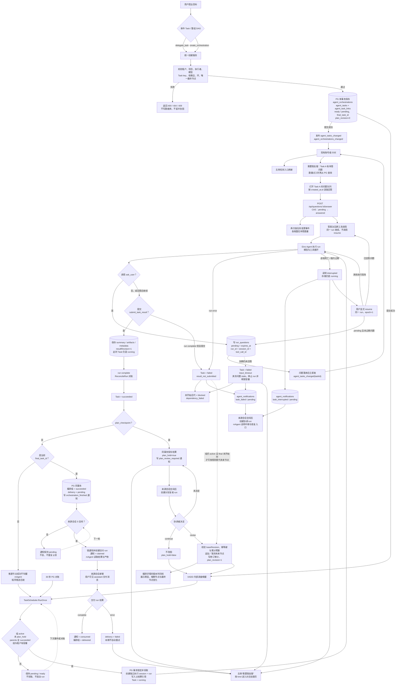

# 72 · 多 Agent 编排下一阶段：有界修订、Task HITL 与事件驱动

> 性质：**已落地**。2026-11-11 用户点头并按施工包一次施工；四条能力（有界修订、Task HITL、左侧提醒、事件唤醒）均已机器与活体验收，commit `a5a9a5e`。
> 施工包：[tmp/72-多Agent编排下一阶段/施工包.md](../tmp/72-多Agent编排下一阶段/施工包.md)（施工期材料，不入库；验收后按 AGENTS 留档到 `doc/log/`）。
> 状态：✅ 已施工；2026-11-11 讨论后成文，同日施工并验收。
> 日期：2026-11-11。
> 代码落点：`internal/runengine/agent_task_{revision,revision_api,attention,scheduler,delivery}.go`、`questions.go`（`expires_at`／115102）、`events.go`（`tk:agent-task-wake`）、`cmd/yktako/main.go`（调度循环）、`web/src/{App.vue,TasksView.vue,api.ts}`；活体 `scripts/acceptance/agent_task_{revision,hitl,attention,wakeup}_live.sh`，契约 `expected.json` 用例 51–54。
> 前置真源：[doc/70](70-多Agent编排与Task/README.md)（持久 Task、固定 DAG、协调通知与单次交付）、[doc/47](47-Plan审核与追问澄清.md)（`run_questions` 与同 run 等人）、[doc/46](46-变更同步与事件通道.md)（账号级 SSE 与失效重拉）、[doc/30](30-崩溃续跑.md)（执行代次与显式恢复）。
> 版本边界：这里的“下一阶段”只指多 Agent 编排能力的后续施工范围，不是运行引擎代际或对外服务版本号。

## 1. 背景：V1 跑通了执行底座，但目标还不能随事实调整

doc/70 V1 已经证明：一件持久 Task 可以独立执行、提交结果、停止和恢复；一张固定 DAG 可以按依赖推进；整组结果可以通过持久协调通知回到来源会话，由 mAgent 创建交付 run 后向用户说明。

下一阶段要补四条彼此相关、但必须分别验收的链：

1. **计划修订**：A 的结果发现还必须做 D 时，当前固定图只能在原目标外另起一组；需要在原编排组内追加 D，并让原汇总 C 等 D。
2. **Task 内 HITL**：执行者遇到歧义时需要问人，但当前 Task 的执行 session 不出现在普通聊天列表，`ask_user` 被移除，因此“问了也没人看见”。
3. **用户提醒与入口**：现有任务页能接收变更事件并重拉，但用户不在任务页时，没有统一的“需要我处理”入口，也缺少从待答、计划待决策、中断或交付失败定位到对应处理页的闭环。
4. **调度唤醒**：Task 调度器现在按固定间隔执行整轮对账；没工作也查库，有工作也可能等到下一轮。需要事件唤醒降低空转和发现延迟，同时保留 PG 对账兜底。

如果只做第 1 条，协调者可以改图，但执行者问不到人；只做第 2 条，问题能落库却无人知晓；只做浏览器提醒而不改调度，提醒可能及时、后台推进仍靠固定轮询。四条需要共享同一套持久事实，但完成线不能互相冒充。

## 2. 范围与明确不做

### 2.1 本期四条完整能力

| 线 | 用户得到什么 | 系统必须证明什么 |
|---|---|---|
| 有界计划修订 | 中间结果可以追加后续工作，不必重开一组 | 已完成工作不重跑；依赖不提前；过期修订被拒绝；累计节点与修订次数有上限；最终仍只交付一次 |
| Task HITL | 在任务详情里回答执行者的问题 | 问题按 Task 隔离；答案写回正确工具调用；普通回答不触发崩溃 resume；等待超时按 `input_timeout` 失败收口 |
| 左侧任务入口与“需要我处理” | 不打开任务页也能发现待答、计划待决策、中断与交付失败 | 提醒及时；点击定位准确；数量以 PG 现读为准；主会话现有问答不被插队 |
| 事件唤醒与慢速对账 | 有新工作时更快发现，事件故障时仍能最终推进 | Redis 只叫醒；事件丢失不丢工作；多副本不重复执行 |

### 2.2 非目标

- 不开放任意改图：不改写 running／succeeded Task 的指令、执行者、模型或历史结果，不删除历史执行事实。
- 不做 Agent 自由群聊、无限共享历史、默认嵌套 DAG、独立协调 Agent 或并行仓库 worktree 合并。
- 不把 Task 的问题平铺进主会话现有 `pendingAsks`；mAgent 与同步子代理的问答交互保持现状。
- 不新增 WebSocket；回答仍走普通 HTTP POST，浏览器只通过既有账号级 SSE 收提醒。
- 不把所有轮询都改成事件：run 帧拉取、`ask_user` 的行等待、watchdog 续约等不在本次范围。
- 不做浏览器关闭后的离线推送，也不新建通知中心或未读表。
- **不在本期自动重试已经 error 的交付 run**。交付可能已有工具副作用或部分输出，事件改造不能成为盲目重放的理由；既有中断恢复继续走显式 resume。恢复契约已单立在 [doc/73](73-协调通知与交付恢复.md)（2026-11-11 **已施工并活体验收**），本方案不重复实现它。

## 3. 先分清四种“通知”

本方案中几个对象都可能被口语叫作“通知”，它们的真身和用途不同：

| 对象 | 真身 | 谁消费 | 回答什么 |
|---|---|---|---|
| Task 问题 | `run_questions` 的一行，含 `run_id / session_id / tool_call_id / status` | Task 执行者和回答问题的用户 | 具体问什么、答到哪个工具调用 |
| 协调通知 | `agent_notifications` 的一行 | Task 调度器 | 是否该在来源会话创建协调／交付 run |
| 浏览器提醒 | 既有 `/api/events` 上的 `{seq,type,id,at}` | 浏览器 | 哪个 Task／编排组变了、该重拉什么 |
| 调度唤醒 | 内部 Redis Stream 的一条提示 | 各引擎副本的 Task 调度器 | 可能有工作，需要执行一轮 PG 对账 |

只有前两类保存业务事实。后两类都只是“叫醒铃”：丢了可以靠重拉或慢速对账恢复，不能从事件内容直接决定执行状态。

最终结果交付仍走：

```text
最终 Task 结果落 PG
→ 协调通知落 agent_notifications
→ 来源 session 创建交付 run
→ mAgent 读取结果并生成 assistant 消息
```

浏览器上的“Task 有待答问题”只是入口提醒，不代替这条最终交付链；调度事件带来的毫秒级发现也只是回执被发现得更早，不是最终结果在毫秒级生成完毕。

## 4. 一场端到端目标：问答与修订都发生在同一组

```text
用户在会话 S：调研 A、B 并生成综合报告
→ mAgent 创建初始图：A、B 并行，C 汇总；A 被标为计划检查点
→ A 执行时发现调研范围不明确，调用 ask_user
→ 问题写入 run_questions，Task A 保持 running，run 仍活着等人
→ 账号级 SSE 告知浏览器 agent_tasks_changed(A)
→ 左侧“任务”出现提醒；用户展开并进入 A，回答当前第一条问题
→ 答案按 question ID CAS 落库；A 的原工具调用得到答案并继续，不创建恢复 run

→ A 提交结果；因为 A 是计划检查点，程序在同一事务中：
   保存 A 成功事实
   暂停本组新的 Task 领取
   写 plan_review_required 协调通知
→ 来源会话 S 空闲后创建计划复核 run
→ mAgent 读取当前图和 A 的结果，发现还需补充 D
→ 调 revise_orchestration：新增 D，新增 D → C，baseRevision=0
→ 程序校验并原子提交，plan_revision 变 1，解除本组领取暂停

→ B、D 按依赖与容量执行；C 必须等 A、B、D 都成功
→ C 提交最终结果；整组只写一条完成协调通知
→ 来源会话 S 创建一次交付 run，向用户交付最终报告
```

这条链同时证明：问答没有进入别的 Task，修订没有重跑 A，新增 D 没有让 C 提前，最终结果没有由浏览器事件代替。

### 4.1 逻辑链路总图



图中有四条不可省略的边界：

- run complete 不等于 Task 成功，必须有当前 run 提交的有效结果；
- 提问落库就通知，不能等 run end；等待答案时 run 仍是 running，正常回答不触发 resume；到期未答按 `input_timeout` 失败收口；
- 普通节点成功不叫醒 mAgent，只有计划检查点、失败、中断和整组完成才创建协调／交付 run；
- SSE 与 XADD 都只是提醒，问题、依赖、结果、执行权和交付状态全部以 PG 为准；待答、计划决策、中断与交付失败共同进入“需要我处理”。

## 5. 有界计划修订

### 5.1 谁触发复核，谁有权改图

mAgent 继续兼任协调职责，不新增独立协调 Agent。协调 run 仍由持久通知事件驱动，不是永久在线进程。

普通 Task 完成仍由程序自动推进，不逐节点叫醒模型。只有以下情况进入计划复核：

1. Task 在创建或修订时被显式标为 `planCheckpoint=true`，并成功提交结果；
2. 既有失败／中断协调通知需要决定后续计划；
3. 用户在来源会话或编排详情中主动要求调整，并给出明确的 `baseRevision`。

失败／中断通知到来后先读组与最终节点状态：只有组仍 `active` 且最终 Task 尚未开始才允许修订；若 V1 已把组收口为 `failed`，协调者只解释失败与可选的新目标，不借修订重新打开旧组。

检查点 Task 成功时，程序在同一笔事务中保存结果、写 `plan_review_required` 通知并置组级 `plan_hold=true`。`plan_hold` 只停止**新的 Task 领取**；已经 running 的其他 Task 不停止，完成后仍正常保存结果。没有它，协调者还在读 A 时，旧 C 可能已经被调度，修订就失去意义。

计划复核 run 只读当前图、结果和授权产物，并额外获得 `revise_orchestration`／`continue_orchestration`；不获得 `ask_user`、新建编排或任意写工具。`continue_orchestration` 不改图，只清除本次暂停。复核 run 没作决定不算批准：组保持暂停，页面显示“等待计划决策”，由用户显式继续或再次要求 mAgent 处理，不自动反复烧模型。

### 5.2 修订命令的真实形状

建议新增同一服务的两个调用面：产品 API 与协调者模型工具。以下是**讨论稿形状，不是已验收字节**：

```http
POST /api/orchestrations/:id/revisions
```

```json
{
  "idempotencyKey": "revision-A-discovered-D",
  "baseRevision": 0,
  "reason": "A 的结果表明必须补充 D",
  "addTasks": [
    {"key": "D", "content": "补充调研 D，写入 d.md", "agent": "researcher", "modelRef": ""}
  ],
  "addLinks": [
    {"parent": "D", "child": "C"}
  ],
  "cancelTasks": [],
  "finalTaskKey": ""
}
```

- `baseRevision`：调用方实际读到并据以决策的图版本。服务端发现当前版本已更大时拒绝，不让旧结果覆盖新事实。
- `idempotencyKey`：一次修订请求的防重身份；同键同命令返回原修订，同键不同命令冲突。
- `reason`：为什么修订，进入审计和协调上下文；它不是调度依据。
- `addTasks`／`addLinks`：新增未来工作和依赖。初始创建与新增节点都可显式携带 `planCheckpoint`（缺省 false）；既有节点不能中途改写这个标记，需要改变检查点位置时用新节点替代。
- `cancelTasks`：明确取消尚未开始、已没有保留价值的 pending／ready／blocked Task。
- `finalTaskKey`：只有替换最终 Task 时填写；空串表示沿用当前最终 Task。

继续原图的入口建议为：

```http
POST /api/orchestrations/:id/continue
```

请求只携带 `baseRevision`。继续是自然幂等的状态操作：同版本重复调用只把 `plan_hold` 置 false，已解除时不发事件、不新增审计。它不创建 Task、不改依赖，也不把 blocked／failed 当成成功。

### 5.3 允许与拒绝的边界

允许：

- 新增 Task、新增边；
- 给尚未 running 的 pending／ready Task 增加 parent；ready 因新增 parent 在同一事务退回 pending；
- 取消 pending／ready／blocked Task；
- 用新 Task 替代失败或指令不合适的旧 Task；
- 在最终 Task 尚未开始时，把 `final_task_id` 指向一个新的或既有但未开始的 Task。

拒绝：

- 修改任何 Task 的既有 `content / agent / modelRef`；
- 修改 running／succeeded Task 的依赖，或取消 running Task 来冒充计划修订；
- 复活 failed／cancelled Task，或把 blocked 当成已成功；
- 删除旧边、旧结果或旧修订记录；
- 最终 Task 已经开始后再修订本组；
- 组已终态或已交付后的修订；
- 环、自依赖、重复 key、跨组／跨租户／跨项目引用；
- 修订后仍有需要执行、却没有路径通向当前最终 Task 的工作。

最后一条防止“新增 D 与最终 C 无关，C 先交付，D 后来才完成”。历史 failed／cancelled／blocked 节点不参与这条活跃路径检查；它们保留作审计，不再被当成待完成工作。

替换一个已 blocked 的旧汇总 C 时，不原地复活 C，而是新增 C2：

```text
旧事实：B failed，C blocked
修订：新增 B2、C2；A → C2，B2 → C2；取消旧 C；finalTaskKey=C2
结果：旧 B、C 的历史仍在，新计划只执行 B2、C2
```

这个例子的前提是失败传播后组仍 `active`（例如还有其他工作在跑）；若所有工作已终态、组已按 V1 收成 `failed`，就只能另建编排组，不能套用这次修订。

V1 的“恰好一个出度为零节点”仍是**初始创建**规则。进入修订后，历史里可以保留旧最终节点；当前交付归属只认 `agent_orchestrations.final_task_id`，但它必须指向本组尚未开始、活跃路径能够到达的节点。

### 5.4 并发与恢复

- 修订、继续、Task 领取和最终交付都在事务内锁定同一个编排组行；统一锁顺序，模型调用不持数据库锁。
- 当前 `plan_revision != baseRevision` 时返回过期冲突；协调者必须重读图与结果后再决定。
- `agent_orchestrations.plan_hash` 永远保留**初始创建计划**的哈希，不能随修订覆盖，否则原创建请求幂等重打会误撞新图。
- 每次接受的修订另写不可变审计行，并递增 `plan_revision`；当前图 = 初始行 + 已接受修订产生的节点／边／取消事实，不靠模型记忆还原。
- 修订提交后进程死亡：图与审计仍在，唤醒丢失由慢速对账兜底；提交前死亡：整笔不存在。
- 修订成功后协调 run 才死亡，不回滚已接受的计划；幂等键防止恢复时再次追加同一批节点。

### 5.5 修订预算与可视审计

动态修订必须同时有数量上限，否则每次检查点都可能以“再补一件工作”为由让一组目标永远扩张：

- 每组累计最多 32 件 Task，**包含历史终态与被取消节点**；不能只数当前活跃节点，否则删除视觉上的旧节点就会变成无限扩容入口。
- 每组最多接受 32 次修订；`continue_orchestration` 不消耗修订次数，达到上限后仍能沿当前图继续或停止。
- 同一检查点、同一 `resultRevision` 的通知由去重键防重，不能靠恢复或重复唤醒绕过预算。
- 超限按 `400 / 117101` 的计划不合法处理，`data.reason` 明确是节点预算还是修订次数耗尽；整次修订不产生部分写入。

每次接受的修订不仅要落库，还要能在编排详情中回看。建议新增：

```http
GET /api/orchestrations/:id/revisions
```

读模型按 `revision` 升序返回 `revision / baseRevision / reason / addTasks / addLinks / cancelTasks / finalTaskKey / sourceRunId / createdAt`。字段来自 `agent_plan_revisions.command_json` 的结构化命令，不让前端重新解析自然语言，也不只展示一份“当前图所以猜不出变化”的结果。

编排详情因此同时呈现两层：当前图回答“现在会怎么跑”，版本时间线回答“第几版基于什么结果、为什么增加或取消了什么、最终节点是否换人”。没有这层，动态修订对用户就是不可解释的黑箱。

## 6. Task HITL：复用现有问答机器，不发明第二条答案路由

### 6.1 执行与回答链

Task 执行者重新获得 `ask_user`；`enter_plan_mode`／`submit_plan` 仍不给 Task，避免把主会话计划审批塞进后台执行者。

```text
执行者调 ask_user(question, options?)
→ 现有 openWaitRow 写 run_questions(pending)，记录执行 run、执行 session、tool_call_id
→ run 保持 running，watchdog 继续续租约，工具等待答案
→ 问题落库成功后发 agent_tasks_changed(taskId)
→ 浏览器收到账号级 SSE，重拉该 Task 的待答事实
→ 用户在 Task 详情回答某张问题卡
→ 现有 POST /api/questions/:id/answer 按 question ID CAS 一答终答
→ 等待中的原工具读到 answered，把答案作为 tool_result 注回同一 run
```

正常回答**不调用 resume**。只有进程死亡、租约过期并形成 interrupted 时，才走 doc/30 的同 run、epoch+1 显式接管；journal 按 `tool_call_id` 对到问题行，pending 继续等，answered 直接注回。

### 6.2 为什么问题一落库就提醒，不能等 run end

等待输入的 run 仍是 running。如果等 run end 才通知，用户不知道要回答，run 又永远等不到答案，双方死等。

提醒文本只说“Task A 有问题需要回答”，不把当时数量写成永久事实。用户点进去时重新查询 PG；若并行工具调用又落了两条，看到更多问题是正常的新事实。未落库的调用不占待答位置、不显示空卡，也不预估“总共还会有几条”。

### 6.3 每个 Task 自己的问题队列

`run_questions` 已按 `run_id` 隔离，无需为了分组再复制一列。Task 的读取关系为：

```text
Task ID
→ agent_tasks.current_run_id
→ run_questions.run_id
→ ORDER BY created_at, id
```

- 只把已落库的行放进该 Task 的 FIFO；后来落库的问题追加到末尾。
- 并行问题没有跨 Task 的全局先后顺序；用户切换 Task 不会让另一组改变顺序。
- 主会话仍按当前 run 的 `GET /api/runs/:runId/questions` 读取，不与 Task 混查。
- Task 停止或 run 已终态时，不能继续把遗留 pending 行计为“正在等待回答”；中断但未接管的 Task 显示既有中断状态，不冒充活跃待答。

建议新增 Task 作用域读面：

```http
GET /api/tasks/:id/questions?status=pending|answered|stale
```

响应复用现有 `questionView` 字段。服务端先按 Task 可见性鉴权，再解析当前执行 run；客户端不需要知道隐藏执行 session，也不传 `agent=mAgent` 之类字符串来区分来源。

回答继续复用现有端点，不新增 `/api/tasks/:id/answer` 这条第二写路。需要确认现有 `viewRun / denyRunWrite` 对 Task 执行 session 的属主判定在真实端点上成立；不可见与非本人统一按既有 404／403 语义处理。

### 6.4 Task 等待输入的截止时间与超时收口

主会话沿用 doc/47 已拍定的无限等待；后台 Task 不能无期限占着执行 run 与租户容量。推荐增加引擎级 `-task-input-timeout`，默认 24 小时，`0` 明确表示不限时；本版不做每租户、每 Task 的另一套覆盖配置。

Task 的 `ask_user` 落行时写入 `expires_at = created_at + 当前配置`；普通 mAgent／同步子代理的问题该列为空，行为不变。Task 问题读面用可选 `expiresAt` 展示截止时间，配置后来变化不回写旧问题。

每轮 `RunOnce` 增加超时检查：找出“属于 Task 当前 run、仍 pending、`expires_at <= now()`”的问题，在 PG 事务中锁定 Task 与问题行后收口：

```text
问题仍未回答且已到截止时间
→ Task = failed，error_code = input_timeout
→ 本 run 其余 pending 问题收 stale
→ 停止当前执行 run，释放执行与租户容量
→ 未开始后代按 dependency_failed 阻断
→ 写 task_failed 协调通知与任务变更事件
→ 左侧待答项消失，任务列表显示失败；mAgent 通过失败协调通知说明超时原因
```

回答与超时并发时仍由 pending 行的锁与 CAS 决定唯一胜者：回答先成功就不许再超时；超时先收口就拒绝迟到答案。已超时 Task 不能通过普通 resume 重新进入等待；组仍 active 且满足 §5 条件时可替代未来工作，组已 failed 则另建编排，不把超时当成成功或崩溃中断。

## 7. 左侧任务入口与“需要我处理”

### 7.1 页面形态

左侧“任务”入口可以展开，而不是只能切到独立任务页。展开后不仅列待答问题，还集中显示所有需要用户介入的持久状态：

```text
任务  4
  A · 待回答（3）
  调研组 · 计划待决策
  B · 已中断，待恢复
  报告组 · 交付失败
```

| 处理项 `kind` | PG 中的判定事实 | 点击后的动作 |
|---|---|---|
| `question` | 当前 Task run 有活跃 pending 问题 | 打开该 Task 的问题区，按 FIFO 回答 |
| `plan_review` | 编排组 `plan_hold=true` | 打开编排详情，查看当前图与修订历史，显式继续或要求 mAgent 复核 |
| `interrupted` | Task 当前 run 租约过期，读侧为 interrupted | 打开 Task 详情，走既有显式恢复 |
| `delivery_failed` | 编排组 `delivery_status=failed` | 打开编排与来源会话查看失败；按 doc/73 由人工显式恢复，不自动重试 |

- 展开列表和处理项都消费真实 API；待答项显示当前数量和最早待答时间。
- 完整问题卡、依赖图与修订时间线不塞进狭窄左侧栏，点击后进入对应 Task／编排详情。
- 独立任务页继续承载全量历史、产物、停止和恢复；左侧是快捷入口，不另存一份任务状态。
- 新到问题只更新所属 Task 的计数，不抢用户正在回答的另一张卡；不同处理项各按自己的持久状态出现和消失。
- 主会话的 `ask_user` 面板保持现有交互，不显示 Task 的问题。

`delivery_failed` 的可见与跳转属于本方案（已落地）；恢复动作、尝试审计和完成后的状态清除由 [doc/73](73-协调通知与交付恢复.md) 定义（该篇 2026-11-11 已落地）。

### 7.2 处理项读面与数量

为避免左侧对每个 Task 分别请求一次问题列表，建议增加一个项目作用域的聚合读面：

```http
GET /api/workspaces/:id/task-attention
```

讨论用 `data` 形状：

```json
{
  "items": [
    {
      "kind": "question",
      "taskId": "at_…",
      "orchestrationId": "or_…",
      "title": "A",
      "count": 3,
      "questionId": "qs_…",
      "runId": "r_…",
      "status": "running",
      "updatedAt": "2026-11-11T08:00:00Z"
    }
  ]
}
```

`kind` 使用上表四个值。`questionId` 是该 Task 当前最早待答问题；组级 `plan_review`／`delivery_failed` 项的 `taskId`、`questionId` 可为空。`count` 只对待答问题表示当前条数，其余处理项为 1。实际字段是否省略由契约拍确定，本图不是已验收字节。

所有处理项都由 PG 现查现算，不建未读表，也不保存第二份计数：

- 活跃待答只统计 Task／run 均仍在执行、租约有效且未超过 `expires_at` 的问题；
- 计划待决策直接读 `plan_hold`，回答“为什么不再领取新工作”；
- 中断沿用当前 run 的租约派生，不另写状态副本；
- 交付失败直接读编排组的 `delivery_status`。

数量与状态都是本次查询快照，不写进 SSE 事件；用户点进去后发现新到问题增多，以新查询为准。

### 7.3 运输：复用账号级 SSE，处理动作走既有 API

复用 doc/46 的 `GET /api/events` 和事件形状，不新增 WebSocket：

- 问题落库、回答成功、超时、停止／恢复导致处理项变化时，在 PG 成功后发布既有 `agent_tasks_changed(taskId)`；
- 全局左侧入口现在也消费这个事件，失效后重拉处理项聚合与展开列表；不再只有 `TasksView` 自己消费；
- 计划复核、修订接受、最终交付与交付失败状态变化继续发 `agent_orchestrations_changed(orchestrationId)`；
- 事件不带处理项正文、答案或数量；刷新、换项目、窗口重新聚焦和 SSE 重连后都从 PG 重建；
- 现有 `last_event_id` 续读和心跳保持不变；回答、恢复、继续与修订仍走各自的 HTTP 端点。

这条浏览器事件链与 §8 的内部调度唤醒链是两个消费者、两种用途，不共享“收到事件就执行”的权力。

## 8. 调度：事件唤醒 + 30 秒 PG 对账

### 8.1 改的是发现工作，不是状态裁决

当前每个副本按 `-task-interval` 固定执行 `RunOnce`。新形态：

```text
创建编排 / Task 终态 / 停止或恢复 / 协调通知落库 / 修订或继续落库
→ PG 提交成功后 XADD 内部调度流：可能有工作
→ 每个副本的调度器 XREAD BLOCK 等待
→ 有提示：立刻执行一轮 RunOnce
→ 无提示：最多睡到对账时点，再执行同一轮 RunOnce
```

建议新增内部键 `tk:agent-task-wake`（有界 Redis Stream），与面向浏览器的 `tk:events:<tid>` 分开。前者是引擎内部唤醒，后者是租户界面失效；不要让浏览器事件承担调度正确性，也不要把内部唤醒直接暴露给页面。

每个副本都可以读到提示并尝试处理；不使用消费者组来分配业务事实。两个副本同时醒来时，仍由现有 PG 行锁、条件更新、唯一索引和会话／租户容量约束决定谁能执行。

### 8.2 对账边界

- 引擎启动后先做一次完整 `RunOnce`，再进入阻塞读，接住启动前已存在的工作。
- 每个副本同一时间只跑一轮；本轮期间到达的多个提示合并成“结束后再跑一轮”，不让多个 `RunOnce` 并发叠在同一副本里。
- 阻塞读必须带超时，或由独立低频计时器触发；不能永久 `XREAD BLOCK` 后又声称有 30 秒对账。
- 推荐对账间隔默认 30 秒；它是故障情况下的发现上限目标，不是最终回答生成时限。
- 对账仍执行当前全部类别：终态 run 对账、中断检测、Task 输入超时收口、失败传播、ready 推进、取消收尾、编排收口、交付对账、ready 领取与协调通知消费。
- “全部类别”不等于无索引全表扫描；各类查询只取待处理行并限批，持续积压时循环后续批次。
- 协调通知消费不能固定取「最早 N 条」就收工：来源会话正忙、认领后真会铸 run 的行本轮跳过并保持 pending；已终止的复核通知（组已继续／停止）与没有交付可做的整组完成通知（组 failed／cancelled）照常进候选并标 consumed。否则忙通知和死通知会永久占住队首，其它会话的交付永远排不到（2026-11-11 活体抓过：DAG 交付被一个挂起会话的旧通知饿死在 pending）。
- PG 已提交但进程在 XADD 前死亡、Redis 重启、流被截断、XADD 失败，都由下一趟对账兜住。
- 调度器本身关闭时仍是关闭；不能把 `-task-interval<=0` 的既有禁用语义偷偷改成仍在后台跑。

### 8.3 哪些轮询不动

本方案不改普通会话的帧拉取、run 状态检查、ask_user 的按 PG 行等待机制、watchdog 续约或记忆 pipeline。Task 超时只是在同一轮 `RunOnce` 里增加 `expires_at` 检查，不另起一套等待器；本次运输改造只替换 Task 调度器“现在可能有工作”的高频发现方式。

## 9. 数据需求与最小存储变化

### 9.1 编排组与 Task

`agent_orchestrations` 增加：

- `plan_revision`：当前已接受修订次数，初始 0；
- `plan_hold`：是否停止新的 Task 领取，等待计划决策。

`final_task_id` 只允许按 §5 的规则在修订事务中改变；原 `plan_hash` 保持不变。组详情 API 增加 `planRevision` 与 `planHold`，让页面能解释“为什么不再领取新工作”。

`agent_tasks` 增加：

- `plan_checkpoint`：成功后是否需要协调者复核计划；
- `created_revision`：由哪一版计划引入，初始节点为 0。

Task 不新增存储状态 `waiting_input`。等待输入是“当前 run 有活跃 pending 问题”的读侧事实，与 interrupted 的派生思路一致。

### 9.2 修订审计

新增 `agent_plan_revisions`，每行回答“谁依据哪一版，为什么提交了什么命令，被接受为哪一版”：

```text
id
tenant_id / orchestration_id
revision / base_revision
source_run_id
idempotency_key / command_hash
command_json
reason
created_at
```

至少约束 `(tenant_id, orchestration_id, idempotency_key)` 唯一与 `(orchestration_id, revision)` 唯一。修订命令保存结构化原文，页面与恢复不重新解析自然语言说明。

### 9.3 问题、通知与事件

- `run_questions` 不加分组列；沿用主键 question ID、`run_id / session_id / tool_call_id` 和 CAS。仅为 Task 问题增加可空 `expires_at`，普通会话为空；为“pending 且已到期”的调度检查补索引，不用全表扫等待历史。
- Task 超时使用既有 `agent_tasks.error_code=input_timeout` 与 `task_failed` 通知，不新增一种组状态或通知类型。
- `agent_notifications` 增加内部 kind `plan_review_required`，去重键至少含检查点 Task 与 `resultRevision`。
- “需要我处理”没有新表：问题、`plan_hold`、中断租约与 `delivery_status` 各自是既有事实来源。
- 浏览器事件沿用现有两类任务事件，不携带状态。
- 新增内部调度 Stream 时，同批更新 doc/16 §2c 的临时键契约；它随部署环境生灭，不是审计存储。

## 10. 权限、安全、观测与既有行为

- 修订、修订历史、继续、读问题、回答和“需要我处理”聚合都走同一来源会话属主与项目可见性链；viewer 的写操作仍被既有角色规则拒绝。
- 模型工具的身份从 run context 取，不信任模型自报 tenant／user／source session；修订目标必须是当前协调 run 所负责的编排组。
- 新执行者与模型在修订写入前重新校验；实际领取时仍按现有装配规则复核，规格中途失效走 `assembly_failed`。
- 下游仍只接收父结果摘要、版本和授权产物路径，不复制完整历史；HITL 不把其他 Task 的问题或答案装进模型输入。
- 现有 PII 出口、沙箱、文件写入锁与原子替换保持不变；并行改仓库仍归 doc/71 的独立边界。
- trace 至少能串联 `orchestrationId / planRevision / taskId / runId / questionId / notificationId`；日志不记答案全文，SSE 不携敏感正文。
- 现有固定 DAG 创建、停止、显式恢复、单次交付 API 保持兼容；新增字段和端点的真实字节必须先 curl 实跑，再进入机器期望。

## 11. 验收与完成线

### 11.1 计划修订：确定性测试

1. `baseRevision` 过期的两个修订只可能有一个先接受，另一个明确冲突，不覆盖图。
2. 同幂等键同命令重打返回同修订，不增加 Task；同键不同命令拒绝。
3. 新增 D → C 后，D 未成功时 C 不 ready；原 ready C 在同一事务退回 pending。
4. 给 running／succeeded Task 加依赖、改内容或替换执行者均被拒绝。
5. 最终 Task 已开始、组已终态或已交付后修订被拒绝。
6. 替换 blocked C 时新增 C2，旧历史保留；不会把旧 C 或失败 B 当成功输入。
7. 修订后每个活跃待执行节点都能到达当前最终 Task，不能留下会晚于交付的孤立工作。
8. `plan_hold=true` 时两个副本都不能领取新 Task；已 running 工作可正常结束并保存结果。
9. 初始 `plan_hash` 在多次修订后仍能正确处理原创建请求的幂等重打。
10. 累计 32 件历史 Task 后不能再新增；取消旧节点不释放节点预算，超限修订没有部分写入。
11. 接受第 33 次修订被拒绝；`continue` 仍可解除暂停，重复检查点通知不消耗额外修订次数。
12. `GET /api/orchestrations/:id/revisions` 与浏览器版本时间线逐项对应真实审计行：base、原因、增删节点、最终节点与来源 run 均可核对。

### 11.2 Task HITL 与“需要我处理”：活体 + 浏览器

1. A、B 各自产生三条问题，A 另有两条稍后才落库；左侧始终按 Task 分组，后到问题只追加到 A。
2. 提醒在第一条问题落库后出现，不等 run end；通知不承诺固定总数，点入后数量来自 PG 当前快照。
3. 用户分别回答 A、B 的问题，答案按 question ID 各回各的工具调用；主会话现有一条 `ask_user` 的展示与回答不受影响。
4. 同一答案重复提交仍是一答终答；另一用户／另一租户不能读或答。
5. 等待期间 `kill -9` 自己启动的隔离引擎：重启后显式 resume，同一 run 接回 pending／answered 问题，不重建整件 Task。
6. 停止或终态后的遗留问题不继续显示为活跃待答；中断时按中断入口处理。
7. 两个浏览器标签和跨副本事件都能让左侧提醒失效重拉；SSE 断线重连、窗口聚焦后 PG 数量一致。
8. 分别制造待答、`plan_hold`、interrupted 与 `delivery_failed`：四种处理项都出现并进入正确页面；前三类在回答、决策或恢复后由 PG 重拉消失。交付失败只验可见与跳转，在独立恢复契约改变服务端状态前不靠本地已读将其隐藏。
9. 用短测试时限制造 `input_timeout`：Task 失败、其余问题收 stale、run 停止并释放容量、后代 blocked、用户收到失败说明；主会话无限等待不变。
10. 回答与超时同时发生只有一个 CAS 胜者；已超时 Task 不能用普通 resume 回到等待，也不产生第二次失败通知。
11. 交付失败只出现处理项与跳转，不因事件唤醒而自动重试交付 run。

### 11.3 事件唤醒与故障兜底

1. 创建、Task 终态、协调通知、修订和继续都能通过事件唤醒下一轮；无工作时不再每秒执行全套查询。
2. 停掉内部唤醒通道，只靠 30 秒对账，现有 single／dag／crash／two_replicas 场景仍能收敛，不丢最终交付。
3. 模拟 PG 提交后、XADD 前进程死亡；下一趟对账能发现，不产生第二个执行 run。
4. 多副本同时收到同一提示，仍只领取一个 Task、只认领一条协调通知。
5. Redis 事件故障不影响 PG 状态正确性；恢复后重拉与重连能重建浏览器视图。

### 11.4 整组最终场景

必须真跑 §4 的完整链：

```text
A 提问并得到回答
→ A 成功后触发计划复核
→ 新增 D → C
→ B、D 完成，C 只执行一次
→ 最终交付 run 在来源会话只产生一次最终交付
```

模型没有按预期提问或修订时登记模型行为问题，不能用假数据冒充引擎验收。接口字节与任务效果分别判定。

### 11.5 标准门禁

施工完成后至少执行：

```bash
cd yk-tako-eino
PATH="$HOME/sdk/go1.27.0/bin:$PATH" go test ./internal/runengine
PATH="$HOME/sdk/go1.27.0/bin:$PATH" go vet ./internal/runengine
PATH="$HOME/sdk/go1.27.0/bin:$PATH" go build ./cmd/yktako
cd web && npm run typecheck && npm run build
```

新增或变化的契约字节同批进入 `contract_test.go`、`scripts/acceptance/expected.json` 与 `doc/19-v6/19v6-04-验收-curl.md`；先对真实服务端 curl，再抄真实字节。新增存储形态、可见性和事件写口时补对应活体，不用单元测试代替浏览器和双副本场景。

### 11.6 本轮验收实录（2026-11-11）

- **机器门禁**：`go test ./internal/runengine` 全绿、`go vet` 与 `go build ./cmd/yktako` 0 错；`npm run typecheck`、`npm run build` 通过（Node 22）。
- **契约**：`expected.json` 用例 51–54 在隔离引擎上逐字节通过；`check-expected.sh` 与散文用例号一致。
- **活体**：revision 68/68、hitl 48/48、attention 39/39、wakeup 14/14；V1 五场回归 single 24/24、busy 14/14、dag 22/22、crash 20/20、two_replicas 13/13。
- **浏览器走查**（隔离引擎 + Vite，seed 四类事实）：左侧「任务」徽标与展开项正确；待答（含同 Task 两条时显示「待回答（2）」）、计划待决策、中断、交付失败四类都能点入对应抽屉；回答后与「继续执行」后条目按 PG 消失；刷新页面后条目从 PG 重建、展开状态保留；编排组抽屉按真实审计行渲染「计划修订 1 / v1 基于 v0 / 新增 d / 依赖 d→p / 来源 run」。
- **未单独走查**：双标签 SSE 失效重拉、`input_timeout` 的 UI 呈现（后端已由 hitl 活体第 9–11 条覆盖）、跨副本浏览器视角；这些不改变本轮已验结论。

## 12. 施工顺序与交付纪律

`tmp/72-多Agent编排下一阶段/施工包.md` 覆盖了完整施工范围；用户点头后按它一次施工，2026-11-11 完工并验收（结果见本文件头与 `doc/README.md` §1；施工包在用户验收后按 AGENTS 纪律留档 `doc/log/`）。本条记录的是当时的施工顺序，不是当前状态。

施工内部按依赖连续推进，不向用户逐拍交审：

1. 先用真实端点钉死修订、修订历史、继续、Task 问题列表与“需要我处理”聚合的请求／响应和错误码；
2. 完成修订预算与审计、图校验、组暂停与并发事务；
3. 接通 Task `ask_user`、持久截止时间、超时收口、现有回答端点和事件写口；
4. 完成左侧展开、Task 问题卡与四类“需要我处理”入口；
5. 把固定 tick 改成事件唤醒 + 低频同一 `RunOnce`；
6. 跑完整单测、契约、双副本、崩溃、事件故障和浏览器场景，主 Agent 审查真实 diff 并重跑关键链。

不能先画假 UI 反推 API，不能只交存储或一个能返回 202 的端点，也不能把“事件发出去了”当成“用户已收到最终答案”。

## 13. 参照取舍

Hermes 源码提供了两个边界证据，而不是一套可直接照搬的动态问题中心：

- `clarify` 一次调用携带固定的 1–5 个问题，表单可以在组内任意顺序作答；它不处理“打开表单后又有其他 Task 动态追加问题”。本方案只借组内问题表的交互，不借它的 session 级 FIFO 混合所有来源。
- 普通 delegate 子代理明确禁用 `clarify`；异步 Kanban 的人机回环是 `needs_input` 阻塞、Task 评论与 unblock 后重新派工，不是按 question ID 接回原工具调用。本方案借“提醒后进入具体 Task”的分流，但保留 tako 已有的同 run 回答与崩溃恢复。

代码证据分别位于 `ref-agent/hermes-agent/tools/clarify_tool.py`、`delegate_tool_toolsets.py`、`kanban_tools_schemas.py` 与 `hermes_cli/kanban_db.py`。不引入 Hermes 的 SQLite、本机进程或评论重派形态。

## 14. 所以这解决了什么

下一阶段不是把 V1 换成“任意动态图”，而是在持久执行底座上补四个可检查的闭环：

- 事实变化时，可以在同一目标下追加未来工作，历史不被重写；累计预算阻止无限扩张，版本时间线让每次改变可解释；
- 执行者需要人时，问题能落库、被看见、被准确回答，并回到原调用；等待超时能释放容量并明确失败，不无限悬挂；
- 用户不在任务页时，也能从左侧“需要我处理”进入待答、计划决策、中断恢复或交付失败现场，且主会话不被插队；
- 正常路径由事件及时叫醒，事件丢失时由 PG 慢速对账收敛。

这样，多 Agent 系统才同时具有“计划能调整、人能参与、入口能看见、故障能恢复”四条能力，而不是只有更多角色名或更多后台轮询。
